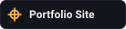
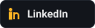
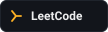
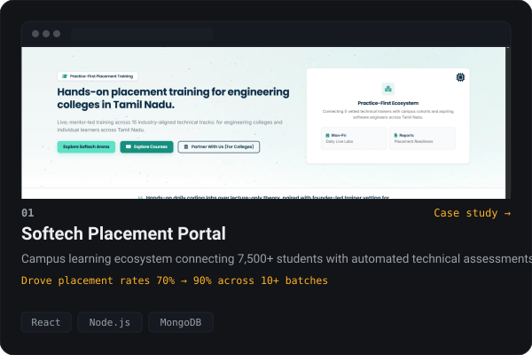
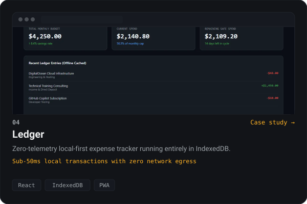

<a href="https://pradeep-b28.github.io/Pradeep-B28/">
  <picture>
    <source media="(prefers-color-scheme: dark)" srcset="assets/readme/header-dark.svg">
    <source media="(prefers-color-scheme: light)" srcset="assets/readme/header-light.svg">
    
  </picture>
</a>

  

<!-- Theme-Aware Custom Badge Buttons (<picture> tags follow GitHub theme setting) -->
<a href="https://pradeep-b28.github.io/Pradeep-B28/"><picture><source media="(prefers-color-scheme: dark)" srcset="assets/readme/badges/badge-portfolio-dark.svg"><source media="(prefers-color-scheme: light)" srcset="assets/readme/badges/badge-portfolio-light.svg"></picture></a>
&nbsp;
<a href="https://mail.google.com/mail/?view=cm&fs=1&to=pradeepbashaa@gmail.com&su=SDE%20Role%20Opportunity%20%E2%80%94%20B%20Pradeep"><picture><source media="(prefers-color-scheme: dark)" srcset="assets/readme/badges/badge-email-dark.svg"><source media="(prefers-color-scheme: light)" srcset="assets/readme/badges/badge-email-light.svg"></picture></a>
&nbsp;
<a href="https://pradeep-b28.github.io/Pradeep-B28/assets/B_Pradeep_Resume.pdf"><picture><source media="(prefers-color-scheme: dark)" srcset="assets/readme/badges/badge-resume-dark.svg"><source media="(prefers-color-scheme: light)" srcset="assets/readme/badges/badge-resume-light.svg"></picture></a>
&nbsp;
<a href="https://www.linkedin.com/in/pradeepb-2k/"><picture><source media="(prefers-color-scheme: dark)" srcset="assets/readme/badges/badge-linkedin-dark.svg"><source media="(prefers-color-scheme: light)" srcset="assets/readme/badges/badge-linkedin-light.svg"></picture></a>
&nbsp;
<a href="https://leetcode.com/u/PradeepKrishB/"><picture><source media="(prefers-color-scheme: dark)" srcset="assets/readme/badges/badge-leetcode-dark.svg"><source media="(prefers-color-scheme: light)" srcset="assets/readme/badges/badge-leetcode-light.svg"></picture></a>

 

### Featured Work

  <a href="https://reachsoftech.onrender.com/home">
    <picture>
      <source media="(prefers-color-scheme: dark)" srcset="assets/readme/cards/card-softech-dark.svg">
      <source media="(prefers-color-scheme: light)" srcset="assets/readme/cards/card-softech-light.svg">
      
    </picture>
  </a>
  &nbsp;
  <a href="https://nammaroute-sigma.vercel.app/">
    <picture>
      <source media="(prefers-color-scheme: dark)" srcset="assets/readme/cards/card-nammaroute-dark.svg">
      <source media="(prefers-color-scheme: light)" srcset="assets/readme/cards/card-nammaroute-light.svg">
      
    </picture>
  </a>

  <a href="https://reachsoftech.onrender.com/home">Live Platform</a> · <a href="https://github.com/Pradeep-B28">Source Code</a>
  &nbsp;&nbsp;&nbsp;&nbsp;&nbsp;&nbsp;&nbsp;&nbsp;&nbsp;&nbsp;&nbsp;&nbsp;&nbsp;&nbsp;&nbsp;&nbsp;&nbsp;&nbsp;&nbsp;&nbsp;&nbsp;&nbsp;&nbsp;&nbsp;&nbsp;&nbsp;&nbsp;&nbsp;&nbsp;&nbsp;&nbsp;&nbsp;&nbsp;&nbsp;&nbsp;&nbsp;&nbsp;&nbsp;&nbsp;&nbsp;&nbsp;&nbsp;&nbsp;&nbsp;&nbsp;&nbsp;&nbsp;&nbsp;&nbsp;&nbsp;&nbsp;&nbsp;&nbsp;&nbsp;&nbsp;&nbsp;&nbsp;&nbsp;&nbsp;&nbsp;&nbsp;&nbsp;
  <a href="https://nammaroute-sigma.vercel.app/">Live Platform</a> · <a href="https://github.com/Pradeep-B28/NammaRoute">Source Code</a>

 

  <a href="https://github.com/Pradeep-B28/SchemaSentinel">
    <picture>
      <source media="(prefers-color-scheme: dark)" srcset="assets/readme/cards/card-schemasentinel-dark.svg">
      <source media="(prefers-color-scheme: light)" srcset="assets/readme/cards/card-schemasentinel-light.svg">
      
    </picture>
  </a>
  &nbsp;
  <a href="https://ledger-mu-nine.vercel.app/">
    <picture>
      <source media="(prefers-color-scheme: dark)" srcset="assets/readme/cards/card-ledger-dark.svg">
      <source media="(prefers-color-scheme: light)" srcset="assets/readme/cards/card-ledger-light.svg">
      
    </picture>
  </a>

  <a href="https://github.com/Pradeep-B28/SchemaSentinel">Source Code</a>
  &nbsp;&nbsp;&nbsp;&nbsp;&nbsp;&nbsp;&nbsp;&nbsp;&nbsp;&nbsp;&nbsp;&nbsp;&nbsp;&nbsp;&nbsp;&nbsp;&nbsp;&nbsp;&nbsp;&nbsp;&nbsp;&nbsp;&nbsp;&nbsp;&nbsp;&nbsp;&nbsp;&nbsp;&nbsp;&nbsp;&nbsp;&nbsp;&nbsp;&nbsp;&nbsp;&nbsp;&nbsp;&nbsp;&nbsp;&nbsp;&nbsp;&nbsp;&nbsp;&nbsp;&nbsp;&nbsp;&nbsp;&nbsp;&nbsp;&nbsp;&nbsp;&nbsp;&nbsp;&nbsp;&nbsp;&nbsp;&nbsp;&nbsp;&nbsp;&nbsp;&nbsp;&nbsp;&nbsp;&nbsp;&nbsp;&nbsp;&nbsp;&nbsp;&nbsp;&nbsp;&nbsp;&nbsp;&nbsp;&nbsp;
  <a href="https://ledger-mu-nine.vercel.app/">Live Platform</a> · <a href="https://github.com/Pradeep-B28/Ledger">Source Code</a>

 

### More I've Built

<b>Algorithms (3)</b>

- **Delivery Rush** — Benchmark your delivery dispatch decisions against autonomous algorithms on live twin maps. · [Live](https://delivery-rush-pi.vercel.app/) · [Code](https://github.com/Pradeep-B28/Delivery_Rush)
- **Split Smart** — Simplifies shared group debts into minimal bank transfers with zero server data tracking. · [Live](https://split-smart-brown.vercel.app/) · [Code](https://github.com/Pradeep-B28/Split_Smart)
- **Java + DSA Roadmap** — A structured curriculum covering Core Java, JVM internals, and interview-ready algorithm patterns. · [Code](https://github.com/Pradeep-B28/JAVA-DSA-Roadmap)

<b>Dev Tools (3)</b>

- **Find the Skills** — Scans resumes against 332 technical skills and 1,901 aliases to identify qualification gaps. · [Live](https://find-the-skills.vercel.app/) · [Code](https://github.com/Pradeep-B28/Find_the_Skills)
- **Rel_Notes** — Transforms raw Git commit histories into structured markdown release notes using LLM inference. · [Code](https://github.com/Pradeep-B28/Rel_Notes)
- **Devstarter** — Provides reproducible, one-click Docker devcontainer environments for Python, Go, Java, Rust, and Node. · [Code](https://github.com/Pradeep-B28/Devstarter)

<b>Games (2)</b>

- **The Broken Website** — Test your web debugging skills across 15 interactive client bug tickets in a sandboxed runtime. · [Live](https://broken-website.vercel.app/) · [Code](https://github.com/Pradeep-B28/Broken_Website)
- **Catch the AI** — Spot subtle algorithmic, concurrency, and syntax bugs in AI-generated code within 30 seconds. · [Live](https://catchtheai.vercel.app/) · [Code](https://github.com/Pradeep-B28/Catch_The_AI)

<b>Privacy & Security (2)</b>

- **Password Crack Meter** — Calculates password crack resistance and patterns using Web Crypto without sending data to servers. · [Live](https://password-check-iota.vercel.app/) · [Code](https://github.com/Pradeep-B28/Password_Crack_Meter)
- **List Cleaner** — Cleans, normalizes, and deduplicates contact lists entirely in your browser with instant CSV export. · [Live](https://listcleaner-mu.vercel.app/) · [Code](https://github.com/Pradeep-B28/List_Cleaner)

<b>Visualizers (5)</b>

- **Explorer** — Inspect how full-stack requests travel across 5 synchronized application layers in real time. · [Live](https://explorer-mu-nine.vercel.app/) · [Code](https://github.com/Pradeep-B28/Explorer)
- **Diwali Sky** — Simulates customizable firework particle explosions and procedural sound synthesis across a night sky. · [Live](https://diwalisky.vercel.app) · [Code](https://github.com/Pradeep-B28/Diwali_Sky)
- **Life in Dots** — Visualizes human lifespan in weekly dot columns with lunar calculations and complete local privacy. · [Live](https://lifeindots.vercel.app) · [Code](https://github.com/Pradeep-B28/Life_In_Dots)
- **Searching & Sorting Visualizer** — Animates sorting and searching algorithm comparisons frame-by-frame in a Java desktop interface. · [Code](https://github.com/Pradeep-B28/JAVA-Searching-Sorting-Visualizer)
- **Portfolio Theme Suite** — Six distinct 3D WebGL developer portfolio prototypes built with custom shaders and spatial layouts. · [Code](https://github.com/Pradeep-B28/Portfolio)

 

### Toolbox

  

 

### Experience

- **Technical Trainer – Academic Excellence**, Sethu Institute of Technology *(Jul 2026 – Present)*
- **Technical Training Programs**: VIT Chennai · VIT Vellore · VIT-AP · KSR Erode *(Nov 2022 – Jul 2026)*
- **10+ Intensive Online Bootcamps**: 7,500+ engineers mentored in Core Java, JVM internals, and algorithmic patterns

 

### Activity

  <picture>
    <source media="(prefers-color-scheme: dark)" srcset="https://github.com/Pradeep-B28/Pradeep-B28/raw/output/profile-3d-contrib/profile-night-rainbow.svg">
    <source media="(prefers-color-scheme: light)" srcset="https://github.com/Pradeep-B28/Pradeep-B28/raw/output/profile-3d-contrib/profile-green-animate.svg">
    
  </picture>

  

  <a href="https://pradeep-b28.github.io/Pradeep-B28/#contact">
    <picture>
      <source media="(prefers-color-scheme: dark)" srcset="assets/readme/footer-dark.svg">
      <source media="(prefers-color-scheme: light)" srcset="assets/readme/footer-light.svg">
      
    </picture>
  </a>
    
  

    Direct: <a href="mailto:pradeepbashaa@gmail.com"><code>pradeepbashaa@gmail.com</code></a> · Open to SDE roles (remote / relocation)
  

