

<a href="https://pradeep-b28.github.io/Pradeep-B28/">
  <picture>
    <source media="(prefers-color-scheme: dark)" srcset="assets/generated/hero-dark.svg">
    <source media="(prefers-color-scheme: light)" srcset="assets/generated/hero-light.svg">
    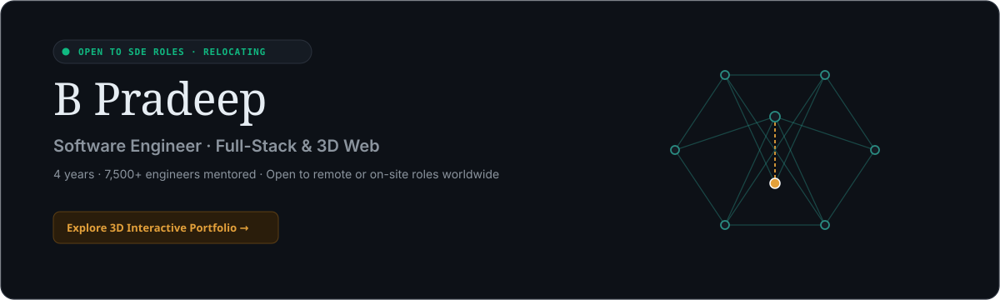
  </picture>
</a>

 

  <a href="mailto:pradeepbashaa@gmail.com?subject=SDE%20Role%20Opportunity%20%E2%80%94%20B%20Pradeep">
    <picture>
      <source media="(prefers-color-scheme: dark)" srcset="assets/generated/btn-email-dark.svg">
      <source media="(prefers-color-scheme: light)" srcset="assets/generated/btn-email-light.svg">
      
    </picture>
  </a>
  &nbsp;
  <a href="https://www.linkedin.com/in/pradeepb-2k/" target="_blank">
    <picture>
      <source media="(prefers-color-scheme: dark)" srcset="assets/generated/btn-linkedin-dark.svg">
      <source media="(prefers-color-scheme: light)" srcset="assets/generated/btn-linkedin-light.svg">
      
    </picture>
  </a>
  &nbsp;
  <a href="https://leetcode.com/u/PradeepKrishB/" target="_blank">
    <picture>
      <source media="(prefers-color-scheme: dark)" srcset="assets/generated/btn-leetcode-dark.svg">
      <source media="(prefers-color-scheme: light)" srcset="assets/generated/btn-leetcode-light.svg">
      
    </picture>
  </a>
  &nbsp;
  <a href="https://pradeep-b28.github.io/Pradeep-B28/" target="_blank">
    <picture>
      <source media="(prefers-color-scheme: dark)" srcset="assets/generated/btn-portfolio-dark.svg">
      <source media="(prefers-color-scheme: light)" srcset="assets/generated/btn-portfolio-light.svg">
      
    </picture>
  </a>

  <a href="https://x.com/Pradeep__krish" target="_blank">
    <picture>
      <source media="(prefers-color-scheme: dark)" srcset="assets/generated/btn-x-dark.svg">
      <source media="(prefers-color-scheme: light)" srcset="assets/generated/btn-x-light.svg">
      
    </picture>
  </a>
  &nbsp;
  <a href="https://www.reddit.com/user/Pradeep_krish/" target="_blank">
    <picture>
      <source media="(prefers-color-scheme: dark)" srcset="assets/generated/btn-reddit-dark.svg">
      <source media="(prefers-color-scheme: light)" srcset="assets/generated/btn-reddit-light.svg">
      
    </picture>
  </a>
  &nbsp;
  <a href="https://www.instagram.com/_._p.r.a.d.e.e.p_._._/" target="_blank">
    <picture>
      <source media="(prefers-color-scheme: dark)" srcset="assets/generated/btn-instagram-dark.svg">
      <source media="(prefers-color-scheme: light)" srcset="assets/generated/btn-instagram-light.svg">
      
    </picture>
  </a>

---

### At a Glance

| 4 Years | 7,500+ | 10+ | 13 |
| :---: | :---: | :---: | :---: |
| **Engineering Experience** | **Engineers Mentored** | **Online Bootcamps** | **Public Repositories** |

**Currently:** Technical Trainer – Academic Excellence, Sethu Institute of Technology, Madurai  
**Previously worked with:** VIT Chennai · VIT Vellore · VIT-AP · KSR (Erode)

---

### Featured Work

<table>
  <tr>
    <td width="50%" valign="top">
      <a href="https://reachsoftech.onrender.com/home">
        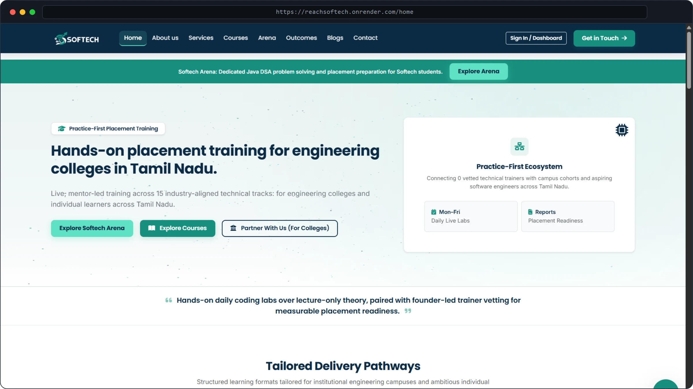
      </a>
      <h4>Softech — Technical Placement Portal</h4>
      
End-to-end corporate career portal and technical learning ecosystem designed for campus recruitment automation, coding arenas, and verified hiring pipelines.

      
<code>Python</code> · <code>Flask 3</code> · <code>PostgreSQL</code> · <code>Render</code> · <code>CodeMirror</code>

      
<b>Highlight:</b> Full production web platform featuring automated code execution and institutional progress dashboards.

      
<i>I build portals like this for clients — <a href="mailto:pradeepbashaa@gmail.com?subject=Website%20or%20Portal%20Project%20%E2%80%94%20B%20Pradeep">email me</a>.</i>

      
<a href="https://reachsoftech.onrender.com/home"><b>Live Platform →</b></a>

    </td>
    <td width="50%" valign="top">
      <a href="https://nammaroute-sigma.vercel.app/">
        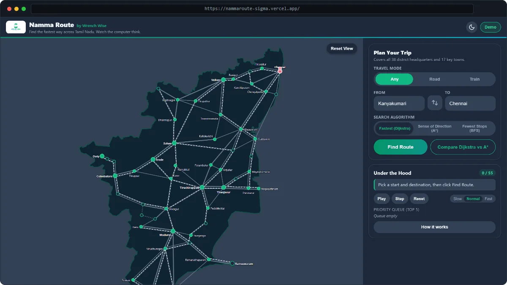
      </a>
      <h4>Namma Route — Tamil Nadu Transit Graph</h4>
      
Interactive multi-modal transit graph visualizer rendering road and rail networks across 55 Tamil Nadu cities (104 nodes, 390 directed edges).

      
<code>JavaScript</code> · <code>Canvas API</code> · <code>A* Heuristic</code> · <code>Dijkstra</code> · <code>Vercel</code>

      
<b>Highlight:</b> Verified against an exhaustive 8,292 automated city-pair test suite with zero routing failures.

      
<a href="https://nammaroute-sigma.vercel.app/"><b>Live App →</b></a> • <a href="https://github.com/Pradeep-B28/Namma_Route"><b>Source Code →</b></a>

    </td>
  </tr>
  <tr>
    <td width="50%" valign="top">
      <a href="https://github.com/Pradeep-B28/Schema_Sentinel">
        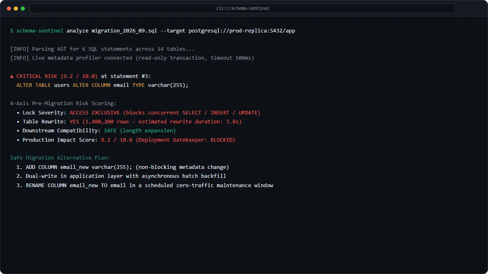
      </a>
      <h4>Schema Sentinel — PostgreSQL Risk Analyzer</h4>
      
Pre-migration risk profiler and CI/CD gatekeeper detecting non-concurrent table locks, rewrites, and breaking schema changes prior to production deployment.

      
<code>Python 3.11</code> · <code>sqlparse</code> · <code>PostgreSQL</code> · <code>GitHub Actions</code>

      
<b>Highlight:</b> AST-based 4-axis risk analysis (Lock, Data Integrity, Compatibility, Performance) blocking unsafe PRs.

      
<a href="https://github.com/Pradeep-B28/Schema_Sentinel"><b>Source &amp; GitHub Action →</b></a>

    </td>
    <td width="50%" valign="top">
      <a href="https://github.com/Pradeep-B28/Ledger_Expense_Tracker">
        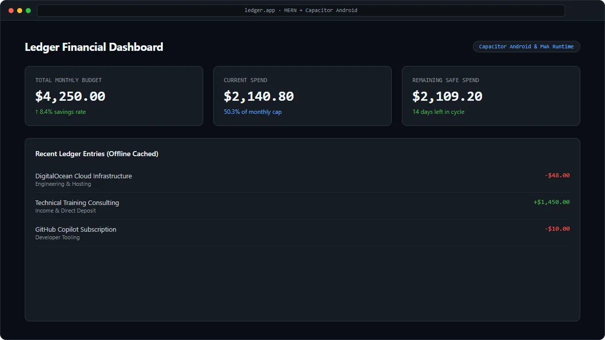
      </a>
      <h4>Ledger — Personal Finance &amp; Expense Tracker</h4>
      
Privacy-focused cross-platform personal finance manager with client-side optimistic UI updates and local caching for mobile and web.

      
<code>React 18</code> · <code>Node.js</code> · <code>Express</code> · <code>MongoDB</code> · <code>Capacitor Android</code>

      
<b>Highlight:</b> Offline-first LocalStorage transaction ledgering with native Android APK packaging via Capacitor.

      
<a href="https://github.com/Pradeep-B28/Ledger_Expense_Tracker"><b>Source Code →</b></a>

    </td>
  </tr>
  <tr>
    <td width="50%" valign="top">
      <a href="https://catchtheai.vercel.app/">
        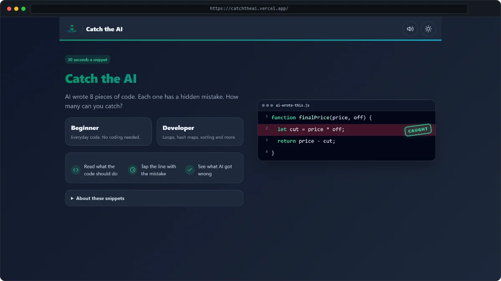
      </a>
      <h4>Catch the AI — Code Review &amp; Debugging Game</h4>
      
Developer debugging game where players spot subtle logic, concurrency, and syntax bugs in AI-generated code snippets within a 30-second countdown.

      
<code>JavaScript</code> · <code>CSS Modules</code> · <code>Decoupled Event Bus</code> · <code>Vercel</code>

      
<b>Highlight:</b> Drift-free high-precision timer engine backed by 20 verified algorithmic bug scenarios.

      
<a href="https://catchtheai.vercel.app/"><b>Live Game →</b></a> • <a href="https://github.com/Pradeep-B28/Catch_The_AI"><b>Source Code →</b></a>

    </td>
    <td width="50%" valign="top">
      <a href="https://diwalisky.vercel.app">
        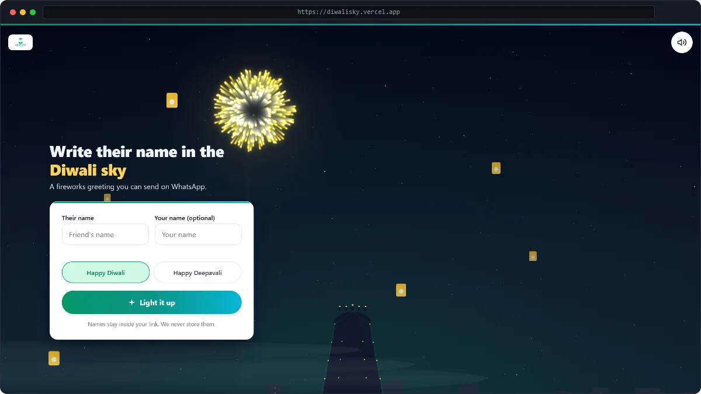
      </a>
      <h4>Diwali Sky — Interactive Fireworks Simulator</h4>
      
Festive physics canvas simulating particle explosion dynamics that write customizable names across a night sky with procedural sound synthesis.

      
<code>JavaScript</code> · <code>HTML5 Canvas</code> · <code>Web Audio API</code> · <code>Vercel</code>

      
<b>Highlight:</b> Client-side mathematical particle explosion physics with real-time audio oscillator generation.

      
<a href="https://diwalisky.vercel.app"><b>Live App →</b></a> • <a href="https://github.com/Pradeep-B28/Diwali_Sky"><b>Source Code →</b></a>

    </td>
  </tr>
  <tr>
    <td width="50%" valign="top">
      <a href="https://find-the-skills.vercel.app/">
        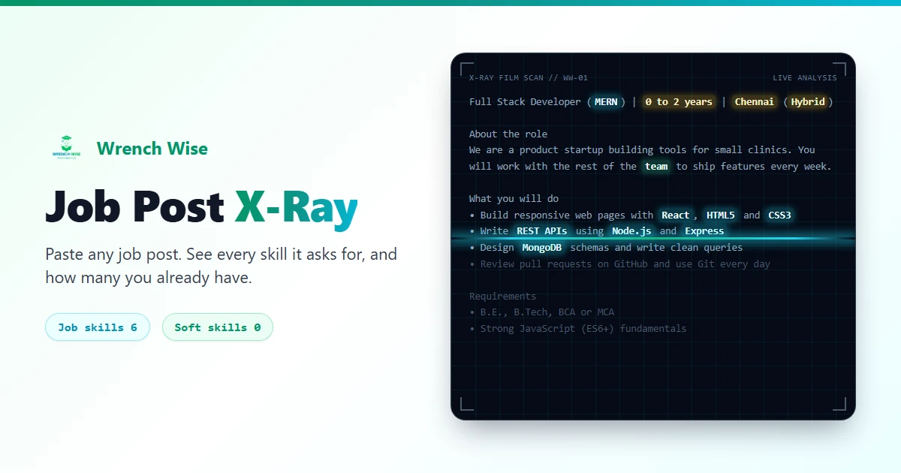
      </a>
      <h4>Find the Skills — ATS Scanner &amp; Career Gap Engine</h4>
      
Interactive client-side ATS lexical keyword scanner and career qualification engine mapping 332 skills across 1,901 aliases with strict word boundary rules.

      
<code>JavaScript</code> · <code>Regex Engine</code> · <code>Web Audio API</code> · <code>Vercel</code>

      
<b>Highlight:</b> Longest-match lexical precedence with context disambiguation window and zero-server privacy.

      
<a href="https://find-the-skills.vercel.app/"><b>Live App →</b></a> • <a href="https://github.com/Pradeep-B28/Find_the_Skills"><b>Source Code →</b></a>

    </td>
    <td width="50%" valign="top">
      <a href="https://lifeindots.vercel.app">
        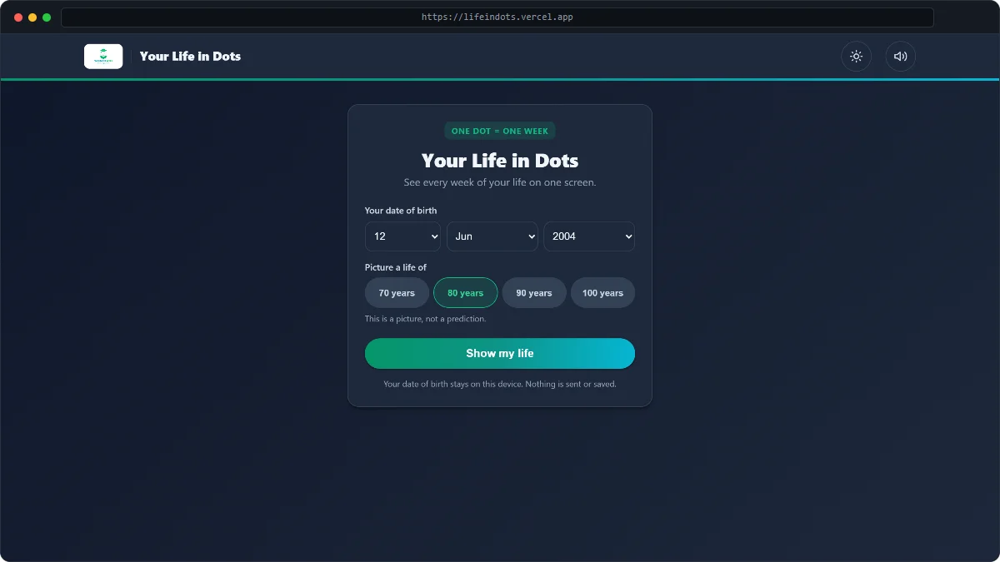
      </a>
      <h4>Life in Dots — Lifespan in Weeks Visualizer</h4>
      
Visual human lifespan calendar mapped in weekly units (52 columns per year) with synodic lunar calculations and 100% client-side privacy.

      
<code>JavaScript</code> · <code>HTML5 Canvas</code> · <code>Integer UTC Math</code> · <code>Vercel</code>

      
<b>Highlight:</b> O(1) grid coordinate arithmetic with high-DPI multi-layer camera pan and zoom.

      
<a href="https://lifeindots.vercel.app"><b>Live App →</b></a> • <a href="https://github.com/Pradeep-B28/Life_In_Dots"><b>Source Code →</b></a>

    </td>
  </tr>
</table>

---

### More Projects

<b>View Additional Systems, Tooling &amp; Curricula</b>

 

- **[Life in Dots](https://lifeindots.vercel.app)** — Visual human lifespan calendar mapped in weekly units (52 columns per year) with synodic lunar calculations and 100% client-side privacy. • [Source](https://github.com/Pradeep-B28/Life_In_Dots)
- **[Rel_Notes](https://github.com/Pradeep-B28/Rel_Notes)** — AI-driven command-line changelog generator leveraging Groq Llama 3.3 70B inference to parse raw git commit histories into domain-grouped markdown release notes.
- **[Devstarter](https://github.com/Pradeep-B28/Devstarter)** — Zero-configuration reproducible Docker devcontainers for Python, Go, Java, Rust, Node.js, and C++.
- **[Java + DSA Master Roadmap](https://github.com/Pradeep-B28/JAVA-DSA-Roadmap)** — Structured curriculum covering Core Java, Object-Oriented Design, JVM internals, and interview-ready algorithmic patterns.
- **[Searching &amp; Sorting Visualizer](https://github.com/Pradeep-B28/JAVA-Searching-Sorting-Visualizer)** — Java Swing GUI application rendering comparisons and swaps frame-by-frame for Quick, Merge, Heap, and Binary Search algorithms.
- **[Portfolio Theme Suite](https://github.com/Pradeep-B28/Portfolio)** — 6 distinct 3D WebGL developer portfolio prototypes built in React 18, Three.js, shaders, and Tailwind CSS.
- **MOR (Private &amp; Proprietary)** — Voice-first holographic personal AI assistant with wake-word detection, neural speech synthesis, and smart room IoT orchestration. *Demo on request — [email me](mailto:pradeepbashaa@gmail.com?subject=Inquiry%20regarding%20MOR%20AI%20Assistant%20Demo%20%E2%80%94%20B%20Pradeep).*

---

### Technical Specialization

<picture>
  <source media="(prefers-color-scheme: dark)" srcset="assets/generated/tech-matrix-dark.svg">
  <source media="(prefers-color-scheme: light)" srcset="assets/generated/tech-matrix-light.svg">
  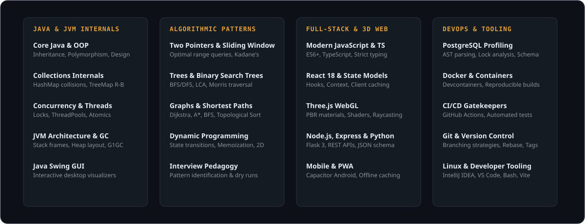
</picture>

<b>Plain-Text Skills Index (Screen Readers &amp; Search)</b>

- **Java &amp; JVM Internals:** Java 8/11/17/21, Object-Oriented Design (Abstract classes, Polymorphism), Collections Framework internals (HashMap collision trees, TreeMap Red-Black invariants, ConcurrentHashMap bucket locking), Concurrency &amp; Multithreading (ExecutorService, CountDownLatch, Atomic types), JVM Memory layout (Stack frames, Heap generational layout, Metaspace), Garbage Collection (G1GC, ZGC tuning), Java Swing GUI.
- **Algorithmic Problem-Solving:** Arrays &amp; Strings (Two Pointers, Sliding Window, Prefix Sums, Kadane's), Trees &amp; BST (BFS/DFS traversals, LCA, Morris traversal), Graphs (Dijkstra, A* with admissible heuristic, Topological Sort, Disjoint Set Union), Dynamic Programming (1D/2D state transitions, Memoization, Tabulation).
- **Full-Stack, Mobile &amp; 3D:** JavaScript (ES6+), TypeScript, React 18, Node.js, Express, Three.js WebGL (PBR materials, Shaders, Raycasting), Python (Flask 3), REST APIs, Mobile packaging (Capacitor Android, PWA, Service Workers).
- **DevOps &amp; Infrastructure:** PostgreSQL (AST parsing, lock mode analysis, schema migrations), Docker, Devcontainers, GitHub Actions CI/CD workflows, Git (branching, rebase workflows), Linux, IntelliJ IDEA, VS Code.

---

### GitHub Activity &amp; Velocity

<picture>
  <source media="(prefers-color-scheme: dark)" srcset="assets/generated/stats-dark.svg">
  <source media="(prefers-color-scheme: light)" srcset="assets/generated/stats-light.svg">
  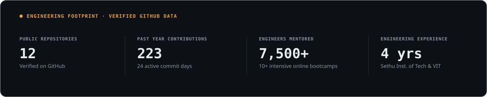
</picture>

  

<picture>
  <source media="(prefers-color-scheme: dark)" srcset="assets/generated/streak-dark.svg">
  <source media="(prefers-color-scheme: light)" srcset="assets/generated/streak-light.svg">
  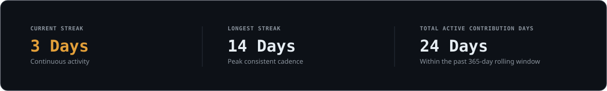
</picture>

  

<picture>
  <source media="(prefers-color-scheme: dark)" srcset="assets/generated/languages-dark.svg">
  <source media="(prefers-color-scheme: light)" srcset="assets/generated/languages-light.svg">
  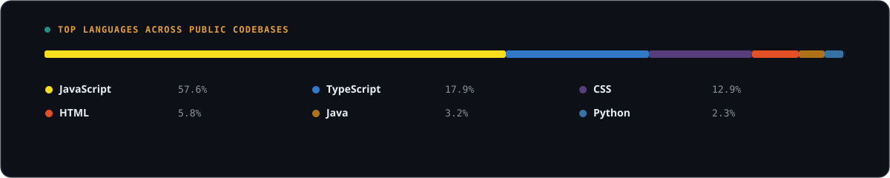
</picture>

  

<picture>
  <source media="(prefers-color-scheme: dark)" srcset="profile-3d-contrib/profile-night-rainbow.svg">
  <source media="(prefers-color-scheme: light)" srcset="profile-3d-contrib/profile-green-animate.svg">
  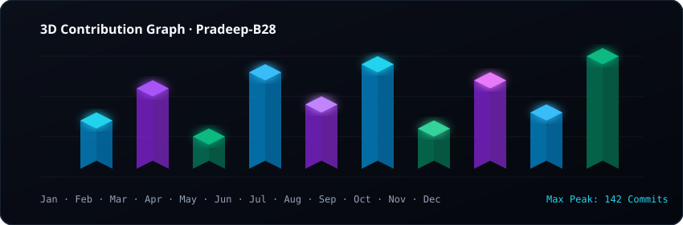
</picture>

---

### Engineering Pedagogy &amp; Mentorship

As Technical Trainer for Academic Excellence at Sethu Institute of Technology and through technical programs with institutions including VIT Chennai, VIT Vellore, VIT-AP, and KSR (Erode), I have mentored **7,500+ students and engineers** across **10+ intensive online bootcamps**.

My training methodology bridges runtime theory with interview-ready execution:
- **Mechanical Sympathy:** Demystifying how JVM memory layout, stack allocation, and garbage collector ergonomics impact real-world latency.
- **Algorithmic Mental Models:** Teaching code patterns through invariant recognition rather than rote memorization — analyzing two-pointer convergence, monotonic stack bounds, and dynamic programming state DAGs.
- **System Discipline:** Emphasizing readable, idiomatic code structure, clean separation of concerns, and defensive data access patterns.

---

### Let's Connect

Open to full-time Software Development Engineer (SDE) roles — available for remote opportunities or on-site relocation.

- 💼 **[Discuss an SDE Opportunity](mailto:pradeepbashaa@gmail.com?subject=SDE%20Role%20Opportunity%20%E2%80%94%20B%20Pradeep)**
- 🎓 **[Corporate Training or Placement Bootcamp](mailto:pradeepbashaa@gmail.com?subject=Technical%20Training%20or%20Bootcamp%20Inquiry%20%E2%80%94%20B%20Pradeep)**
- 🌐 **[Custom Website or 3D WebGL Project](mailto:pradeepbashaa@gmail.com?subject=Website%20or%203D%20Project%20Collaboration%20%E2%80%94%20B%20Pradeep)**
- 🤖 **[Request a Demo of MOR AI Assistant](mailto:pradeepbashaa@gmail.com?subject=Inquiry%20regarding%20MOR%20AI%20Assistant%20Demo%20%E2%80%94%20B%20Pradeep)**

---

  

© 2026 B Pradeep · Code in this repository is <a href="LICENSE">MIT-licensed</a>.

