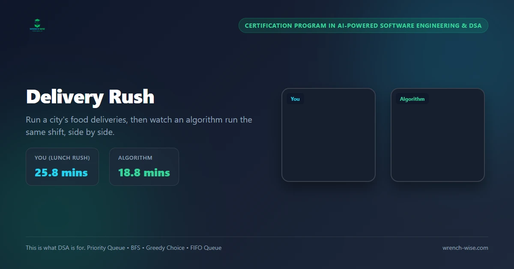
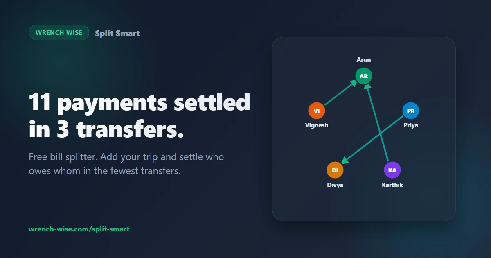
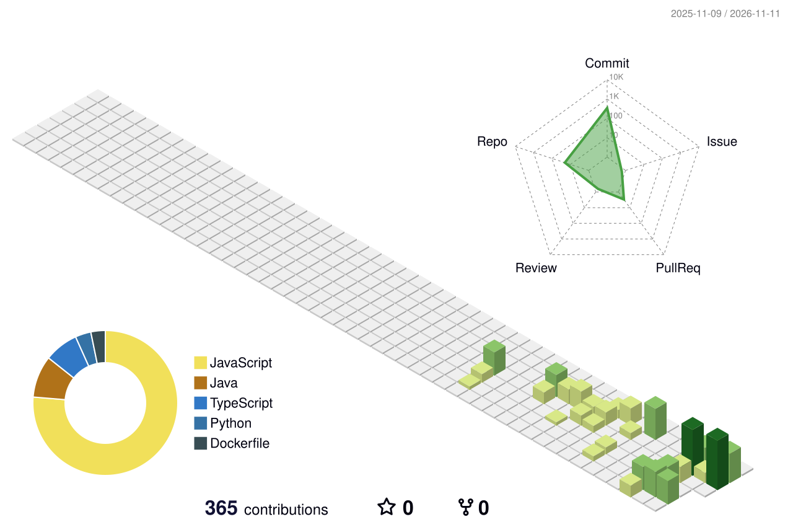

  

  4 years building systems. Open to SDE roles, remote or on-site.

  
  
  
  

---

## About me

I build full-stack platforms, database safety tooling and algorithm visualizers, and I teach the same ideas in the classroom.

- **Engineer:** placement portals, PostgreSQL migration tooling, cross-platform apps and 3D web experiences
- **Teacher:** 7,500+ students and engineers mentored across 10+ intensive bootcamps
- **Now:** Technical Trainer, Academic Excellence, Sethu Institute of Technology, Madurai
- **Looking for:** a full-time software engineer role in backend, full-stack or 3D web

## How I build

| Private by default | Proven by tests | Built to be understood |
|:--|:--|:--|
| Several of my tools run entirely in the browser under a strict no-network policy, so user data never leaves the device. | Engines ship with their own checks: 47,475 for Split Smart, 21,929 for List Cleaner, 8,292 route tests for Namma Route. | Most projects are visual: you can watch the algorithm work instead of reading about it. |

## Featured projects

<table>
<tr>
<td width="50%" valign="top">

<h3>Softech</h3>
Placement portal for campus recruitment drives, live training and candidate evaluation. In production. 
Python, Flask 3, PostgreSQL, Render 
<a href="https://reachsoftech.onrender.com/home"><b>Live app</b></a>
</td>
<td width="50%" valign="top">

<h3>Namma Route</h3>
Road and rail pathfinding across 55 Tamil Nadu cities, comparing Dijkstra, A* and BFS. 8,292 city-pair tests, zero failures. 
JavaScript, Canvas, A*, Dijkstra 
<a href="https://nammaroute-sigma.vercel.app/"><b>Live app</b></a> | <a href="https://github.com/Pradeep-B28/Namma_Route">Source</a>
</td>
</tr>
<tr>
<td valign="top">

<h3>Schema Sentinel</h3>
Catches table locks, rewrites and breaking schema changes in PostgreSQL migrations, and blocks unsafe pull requests in CI. 
Python 3.11, sqlparse, PostgreSQL, GitHub Actions 
<a href="https://github.com/Pradeep-B28/Schema_Sentinel"><b>Source</b></a>
</td>
<td valign="top">

<h3>Ledger</h3>
Personal finance tracker for web and Android with optimistic updates and offline-first storage. 
React 18, Node.js, MongoDB, Capacitor 
<a href="https://github.com/Pradeep-B28/Ledger_Expense_Tracker"><b>Source</b></a>
</td>
</tr>
<tr>
<td valign="top">

<h3>Delivery Rush</h3>
A dispatch game: your decisions against a bot running Min-Heap, BFS and greedy strategies. 3,592 passing headless checks. 
JavaScript, SVG, Min-Heap, BFS 
<a href="https://delivery-rush-pi.vercel.app/"><b>Live app</b></a> | <a href="https://github.com/Pradeep-B28/Delivery_Rush">Source</a>
</td>
<td valign="top">

<h3>Split Smart</h3>
Group expense splitter that settles debts in the fewest transfers, using exact integer paise math and bitmask DP. 
JavaScript, Bitmask DP, strict CSP 
<a href="https://split-smart-brown.vercel.app/"><b>Live app</b></a> | <a href="https://github.com/Pradeep-B28/Split_Smart">Source</a>
</td>
</tr>
</table>

<b>See all the other projects (19 more)</b>

 

| Project | What it does | Links |
|:--|:--|:--|
| **Dream Site Swipe** | Card-swiping website design discovery engine synthesizing design blueprints and starter CSS with 95,692 verification checks | [Live](https://dream-site-zeta.vercel.app/) · [Source](https://github.com/Pradeep-B28/Dream_Site) |
| **The Website Price Tag** | Interactive taxi-style web development cost estimator for Indian agency rates in 2026 with 31,808 verification checks | [Live](https://website-price-three.vercel.app/) · [Source](https://github.com/Pradeep-B28/Website_Price) |
| **Sketch the Site** | Wireframe-to-website builder turning hand-drawn sketches into responsive HTML/CSS layouts | [Live](https://sketch-the-site.vercel.app/) · [Source](https://github.com/Pradeep-B28/Sketch_the_Site) |
| **Bunk Meter** | Privacy-first college attendance threshold calculator and bunk planning engine | [Live](https://bunk-meter-one.vercel.app/) · [Source](https://github.com/Pradeep-B28/Bunk_Meter) |
| **Explorer** | A food-delivery app split into five synced layers, with data packets you can follow from screen to database | [Live](https://explorer-mu-nine.vercel.app/) · [Source](https://github.com/Pradeep-B28/Explorer) |
| **Catch the AI** | Spot the bug in AI-generated code before a 30-second timer runs out | [Live](https://catchtheai.vercel.app/) · [Source](https://github.com/Pradeep-B28/Catch_The_AI) |
| **The Broken Website** | Debugging escape room with 15 bug tickets, a live editor and sandboxed execution | [Live](https://broken-website.vercel.app/) · [Source](https://github.com/Pradeep-B28/Broken_Website) |
| **Password Crack Meter** | Password strength and pattern analyzer that never touches the network | [Live](https://password-check-iota.vercel.app/) · [Source](https://github.com/Pradeep-B28/Password_Crack_Meter) |
| **Find the Skills** | Client-side ATS keyword scanner and skill-gap finder for résumés | [Live](https://find-the-skills.vercel.app/) · [Source](https://github.com/Pradeep-B28/Find_the_Skills) |
| **List Cleaner** | Contact list deduplication and cleanup, entirely in the browser | [Live](https://listcleaner-mu.vercel.app/) · [Source](https://github.com/Pradeep-B28/List_Cleaner) |
| **Diwali Sky** | Particle fireworks that write any name across a night sky, with synthesized sound | [Live](https://diwalisky.vercel.app) · [Source](https://github.com/Pradeep-B28/Diwali_Sky) |
| **Life in Dots** | A whole human lifespan drawn as one dot per week | [Live](https://lifeindots.vercel.app) · [Source](https://github.com/Pradeep-B28/Life_In_Dots) |
| **GIT-viz** | Turns any GitHub profile into a 3D city skyline or repo galaxy | [Live](https://pradeep-b28.github.io/GIT_3D_Portfolio/) · [Source](https://github.com/Pradeep-B28/GIT_3D_Portfolio) |
| **Rel_Notes** | Command-line tool that turns git commit history into release notes using Groq | [Source](https://github.com/Pradeep-B28/Rel_Notes) |
| **Devstarter** | One-click devcontainers for Python, Node, Go, Rust, C++ and Java | [Source](https://github.com/Pradeep-B28/Devstarter) |
| **Java and DSA roadmap** | Beginner-to-advanced curriculum for Core Java, JVM internals and interview algorithms | [Roadmap](https://github.com/Pradeep-B28/JAVA-DSA-Roadmap) |
| **Sorting visualizer** | Java Swing app that animates six sorts and binary search step by step | [Source](https://github.com/Pradeep-B28/JAVA-Searching-Sorting-Visualizer) |
| **Portfolio theme suite** | Six 3D portfolio themes built with React 18 and Three.js | [Source](https://github.com/Pradeep-B28/Portfolio) |
| **MOR** | Private voice-first AI assistant with wake word, neural speech and smart-room control | [Request a demo](mailto:pradeepbashaa@gmail.com?subject=MOR%20demo%20request) |

## Skills

  

| Java and the JVM | Algorithms | Full-stack and 3D web | Data and DevOps |
|:--|:--|:--|:--|
| Core Java, OOP, design patterns | Sliding window, two pointers | JavaScript and TypeScript | PostgreSQL lock analysis, migrations |
| Collections internals | Trees: BFS, DFS, LCA | React 18, Node.js, Express | MongoDB |
| Concurrency: executors, locks | Graphs: Dijkstra, A* | Python and Flask 3 | Docker and devcontainers |
| Memory layout and G1GC tuning | Dynamic programming | Three.js, shaders, particles | GitHub Actions pipelines |

## Teaching

| Where | Role |
|:--|:--|
| Sethu Institute of Technology, Madurai | Technical Trainer, Academic Excellence (current) |
| VIT Chennai, VIT Vellore, VIT-AP | Intensive technical training programs |
| KSR, Erode | Intensive technical training programs |

I teach patterns students can rebuild from scratch: window bounds, monotonic stacks, DP state graphs, and how the JVM actually spends memory and time.

## Live GitHub activity

  <picture>
    <source media="(prefers-color-scheme: dark)" srcset="profile-3d-contrib/profile-night-rainbow.svg">
    
  </picture>

  
  

  

  <picture>
    <source media="(prefers-color-scheme: dark)" srcset="profile/snake-dark.svg">
    
  </picture>

### What I did recently

<!--START_SECTION:activity-->
1. 🎉 Merged PR [#2](https://github.com/Pradeep-B28/Pradeep-B28/pull/2) in [Pradeep-B28/Pradeep-B28](https://github.com/Pradeep-B28/Pradeep-B28)
2. 💪 Opened PR [#2](https://github.com/Pradeep-B28/Pradeep-B28/pull/2) in [Pradeep-B28/Pradeep-B28](https://github.com/Pradeep-B28/Pradeep-B28)
3. 🎉 Merged PR [#1](https://github.com/Pradeep-B28/Pradeep-B28/pull/1) in [Pradeep-B28/Pradeep-B28](https://github.com/Pradeep-B28/Pradeep-B28)
4. 💪 Opened PR [#1](https://github.com/Pradeep-B28/Pradeep-B28/pull/1) in [Pradeep-B28/Pradeep-B28](https://github.com/Pradeep-B28/Pradeep-B28)
<!--END_SECTION:activity-->

## Contact

Email is the fastest way to reach me: **[pradeepbashaa@gmail.com](mailto:pradeepbashaa@gmail.com)**

| For | Write with the subject |
|:--|:--|
| A software engineer role | [SDE role](mailto:pradeepbashaa@gmail.com?subject=SDE%20role%20for%20B%20Pradeep) |
| Java and DSA training or a bootcamp | [Training inquiry](mailto:pradeepbashaa@gmail.com?subject=Training%20or%20bootcamp%20inquiry) |
| A website, portal or 3D build | [Website project](mailto:pradeepbashaa@gmail.com?subject=Website%20or%203D%20project) |

[LinkedIn](https://www.linkedin.com/in/pradeepb-2k/) · [LeetCode](https://leetcode.com/u/PradeepKrishB/) · [X](https://x.com/Pradeep__krish) · [Reddit](https://www.reddit.com/user/Pradeep_krish/) · [Instagram](https://www.instagram.com/_._p.r.a.d.e.e.p_._._/) · [Portfolio](https://pradeep-b28.github.io/Pradeep-B28/)
