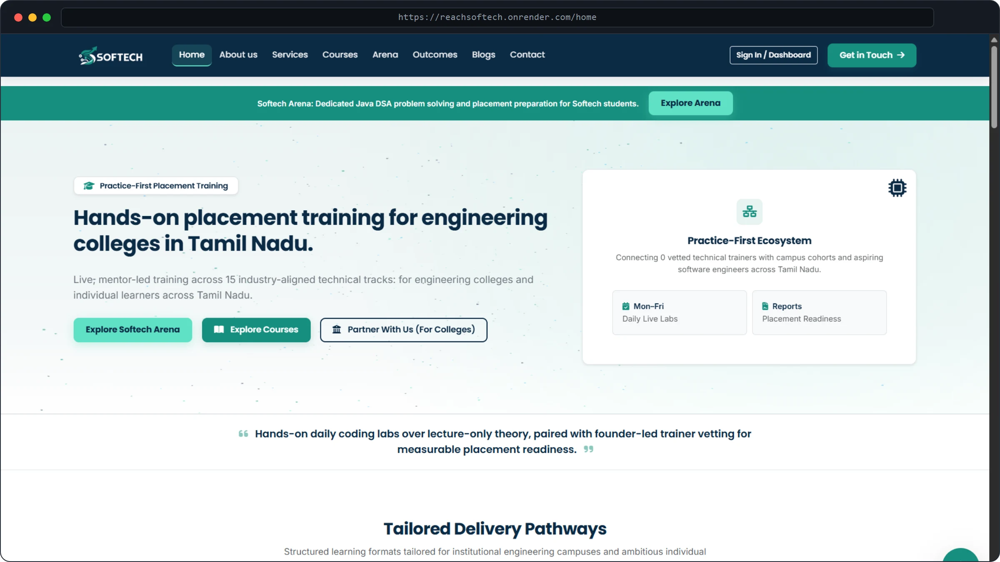
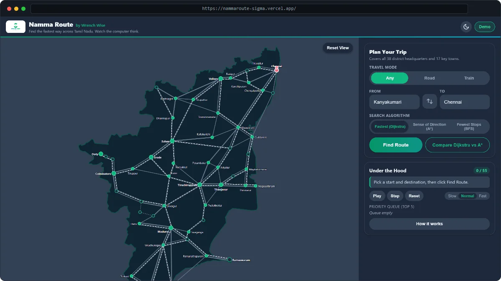
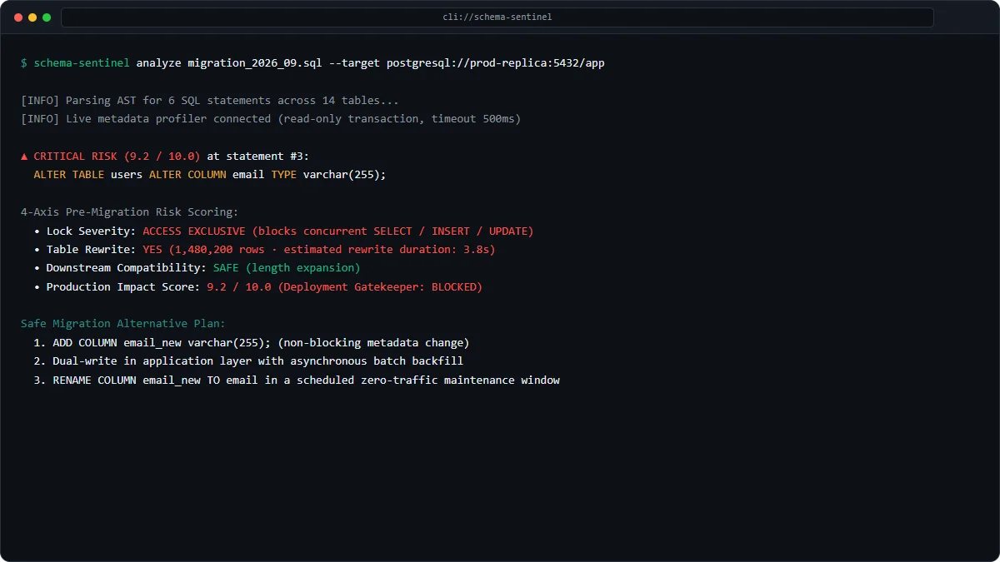
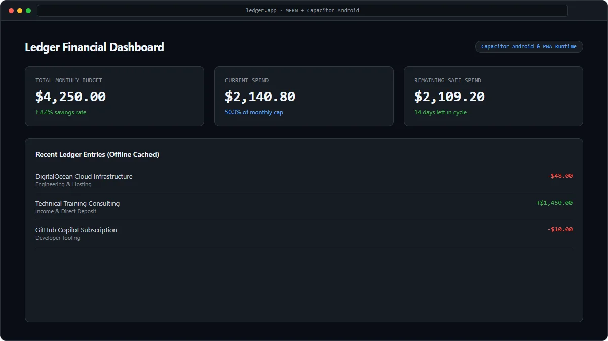
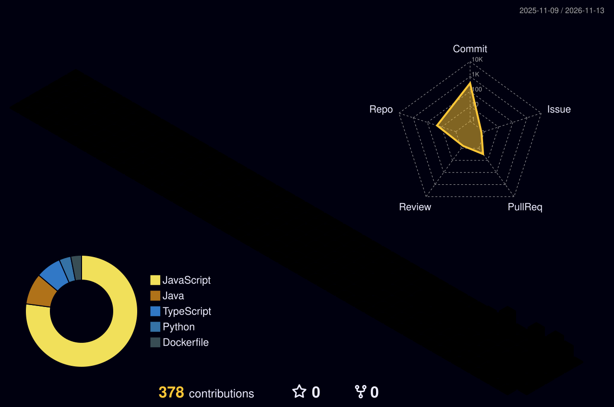

<a href="https://pradeep-b28.github.io/Pradeep-B28/">
  <picture>
    <source media="(prefers-color-scheme: dark)" srcset="assets/readme/header-dark.svg">
    <source media="(prefers-color-scheme: light)" srcset="assets/readme/header-light.svg">
    
  </picture>
</a>

  <a href="https://pradeep-b28.github.io/Pradeep-B28/"><b>Portfolio</b></a> &nbsp;·&nbsp;
  <a href="https://www.linkedin.com/in/pradeepb-2k/"><b>LinkedIn</b></a> &nbsp;·&nbsp;
  <a href="mailto:pradeepbashaa@gmail.com?subject=SDE%20Role%20Opportunity%20%E2%80%94%20B%20Pradeep"><b>Email</b></a> &nbsp;·&nbsp;
  <a href="https://leetcode.com/u/PradeepKrishB/"><b>LeetCode</b></a>

---

### Featured

<table>
  <tr>
    <td width="50%" valign="top">
      
       
      <b>Softech Placement Portal</b>
      
A technical placement platform I designed and built with in-browser code execution and candidate tracking dashboards.

      
<a href="https://reachsoftech.onrender.com/home"><b>Live Platform →</b></a>

    </td>
    <td width="50%" valign="top">
      
       
      <b>Namma Route</b>
      
Finds and visualizes optimal transit routes across 55 Tamil Nadu cities using graph pathfinding.

      
<a href="https://nammaroute-sigma.vercel.app/"><b>Live App →</b></a> &nbsp;·&nbsp; <a href="https://github.com/Pradeep-B28/Namma_Route"><b>Code →</b></a>

    </td>
  </tr>
  <tr>
    <td width="50%" valign="top">
      
       
      <b>Schema Sentinel</b>
      
Prevents database outages by analyzing SQL migration files for destructive table locks before deployment.

      
<a href="https://github.com/Pradeep-B28/Schema_Sentinel"><b>Code →</b></a>

    </td>
    <td width="50%" valign="top">
      
       
      <b>Ledger</b>
      
Tracks personal expenses with instant local updates and offline-first mobile sync.

      
<a href="https://github.com/Pradeep-B28/Ledger_Expense_Tracker"><b>Code →</b></a>

    </td>
  </tr>
</table>

---

### More I've Built

| Project | What it does | Stack | Links |
| :--- | :--- | :--- | :--- |
| **Delivery Rush** | Benchmark your delivery dispatch decisions against autonomous algorithms on live twin maps. | `JavaScript` · `Canvas API` · `Min-Heap` | [Live](https://delivery-rush-pi.vercel.app/) &nbsp;·&nbsp; [Code](https://github.com/Pradeep-B28/Delivery_Rush) |
| **Split Smart** | Simplifies shared group debts into minimal bank transfers with zero server data tracking. | `JavaScript` · `Bitmask DP` · `Greedy DSA` | [Live](https://split-smart-brown.vercel.app/) &nbsp;·&nbsp; [Code](https://github.com/Pradeep-B28/Split_Smart) |
| **Explorer** | Inspect how full-stack requests travel across 5 synchronized application layers in real time. | `JavaScript` · `Canvas API` · `Web Audio` | [Live](https://explorer-mu-nine.vercel.app/) &nbsp;·&nbsp; [Code](https://github.com/Pradeep-B28/Explorer) |
| **The Broken Website** | Test your web debugging skills across 15 interactive client bug tickets in a sandboxed runtime. | `JavaScript` · `Sandboxed Iframe` · `CSP` | [Live](https://broken-website.vercel.app/) &nbsp;·&nbsp; [Code](https://github.com/Pradeep-B28/Broken_Website) |
| **Password Crack Meter** | Calculates password crack resistance and patterns using Web Crypto without sending data to servers. | `JavaScript` · `Web Crypto` · `Hash Set DSA` | [Live](https://password-check-iota.vercel.app/) &nbsp;·&nbsp; [Code](https://github.com/Pradeep-B28/Password_Crack_Meter) |
| **List Cleaner** | Cleans, normalizes, and deduplicates contact lists entirely in your browser with instant CSV export. | `JavaScript` · `Hash Set DSA` · `Merge Sort` | [Live](https://listcleaner-mu.vercel.app/) &nbsp;·&nbsp; [Code](https://github.com/Pradeep-B28/List_Cleaner) |
| **Find the Skills** | Scans resumes against 332 technical skills and 1,901 aliases to identify qualification gaps. | `JavaScript` · `Regex Engine` · `Web Audio` | [Live](https://find-the-skills.vercel.app/) &nbsp;·&nbsp; [Code](https://github.com/Pradeep-B28/Find_the_Skills) |
| **Catch the AI** | Spot subtle algorithmic, concurrency, and syntax bugs in AI-generated code within 30 seconds. | `JavaScript` · `CSS Modules` · `Event Bus` | [Live](https://catchtheai.vercel.app/) &nbsp;·&nbsp; [Code](https://github.com/Pradeep-B28/Catch_The_AI) |
| **Diwali Sky** | Simulates customizable firework particle explosions and procedural sound synthesis across a night sky. | `JavaScript` · `Canvas API` · `Web Audio` | [Live](https://diwalisky.vercel.app) &nbsp;·&nbsp; [Code](https://github.com/Pradeep-B28/Diwali_Sky) |
| **Life in Dots** | Visualizes human lifespan in weekly dot columns with lunar calculations and complete local privacy. | `JavaScript` · `Canvas API` · `UTC Math` | [Live](https://lifeindots.vercel.app) &nbsp;·&nbsp; [Code](https://github.com/Pradeep-B28/Life_In_Dots) |
| **Rel_Notes** | Transforms raw Git commit histories into structured markdown release notes using LLM inference. | `Python` · `Groq LLM` · `Click` | [Code](https://github.com/Pradeep-B28/Rel_Notes) |
| **Devstarter** | Provides reproducible, one-click Docker devcontainer environments for Python, Go, Java, Rust, and Node. | `Docker` · `Devcontainers` · `Linux` | [Code](https://github.com/Pradeep-B28/Devstarter) |
| **Java + DSA Roadmap** | A structured curriculum covering Core Java, JVM internals, and interview-ready algorithm patterns. | `Java` · `JVM Internals` · `Algorithms` | [Code](https://github.com/Pradeep-B28/JAVA-DSA-Roadmap) |
| **Searching &amp; Sorting Visualizer** | Animates sorting and searching algorithm comparisons frame-by-frame in a Java desktop interface. | `Java` · `Java Swing` · `Algorithms` | [Code](https://github.com/Pradeep-B28/JAVA-Searching-Sorting-Visualizer) |
| **Portfolio Theme Suite** | Six distinct 3D WebGL developer portfolio prototypes built with custom shaders and spatial layouts. | `React` · `Three.js` · `WebGL` | [Code](https://github.com/Pradeep-B28/Portfolio) |

---

### Toolbox

  

---

### Experience

- **Technical Trainer – Academic Excellence**, Sethu Institute of Technology *(Current)* <!-- TODO: Pradeep to fill start date -->
- **Technical Training Programs**: VIT Chennai · VIT Vellore · VIT-AP · KSR Erode <!-- TODO: Pradeep to fill dates -->
- **10+ Intensive Online Bootcamps**: 7,500+ engineers mentored in Core Java, JVM internals, and algorithmic patterns <!-- TODO: Pradeep to fill dates -->

---

### Activity

  <picture>
    <source media="(prefers-color-scheme: dark)" srcset="https://github.com/Pradeep-B28/Pradeep-B28/raw/output/profile-3d-contrib/profile-night-rainbow.svg">
    <source media="(prefers-color-scheme: light)" srcset="https://github.com/Pradeep-B28/Pradeep-B28/raw/output/profile-3d-contrib/profile-green-animate.svg">
    
  </picture>

---

  Open to SDE roles — <a href="mailto:pradeepbashaa@gmail.com">pradeepbashaa@gmail.com</a>

